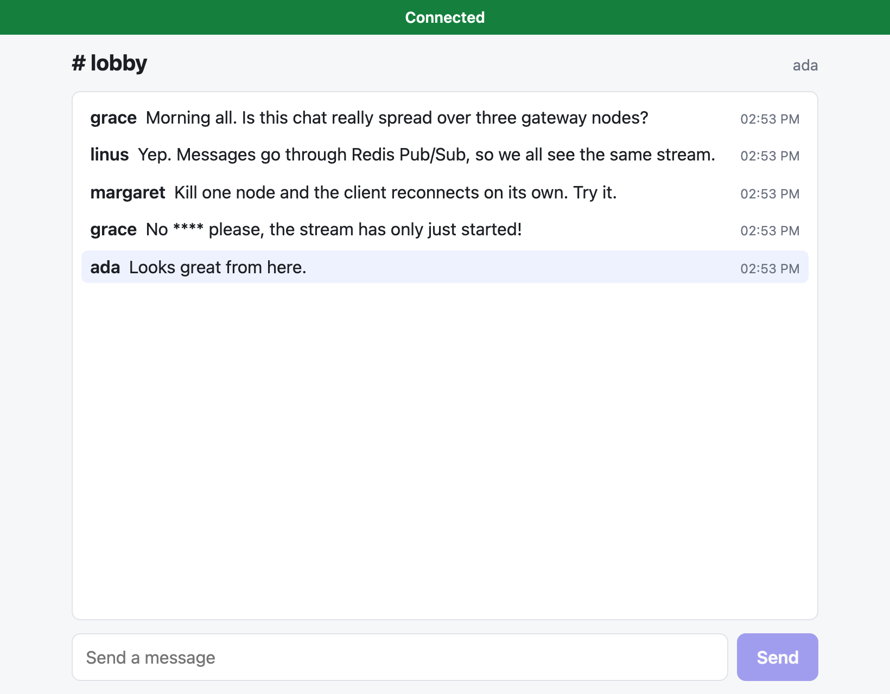
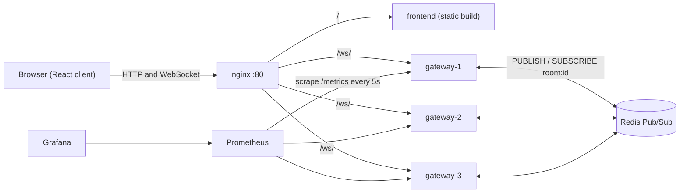
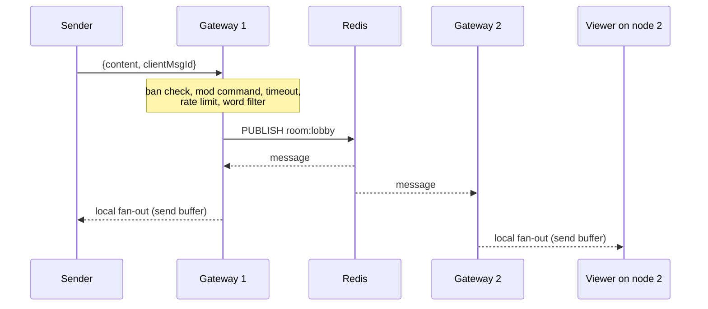
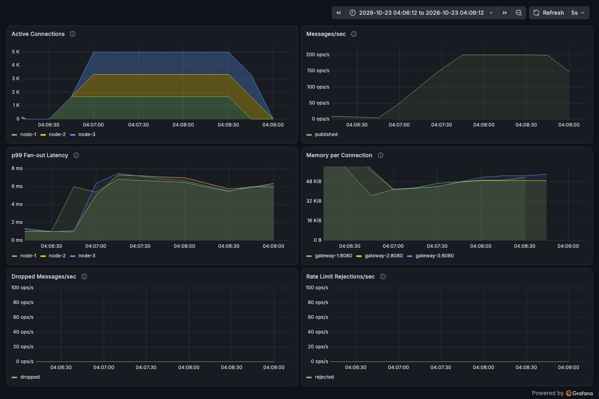

# ChatScale

A horizontally scaled live chat service in Go, built to deliver one room's messages to thousands of viewers across several gateway nodes. WebSocket gateways fan messages out through Redis Pub/Sub, a React client reconnects on its own, and every node exports Prometheus metrics to a Grafana dashboard.


<p align="center">
  
</p>

**Measured locally on one 18-core laptop:** 9,000 concurrent viewers across 3 gateway nodes (1.8 million message deliveries per second) at a median p99 delivery latency of 62 ms. See [Performance](#performance) for the method, the caveats, and what limited it.

## Contents

- [Features](#features)
- [Architecture](#architecture)
- [Quick start](#quick-start)
- [WebSocket API](#websocket-api)
- [Configuration](#configuration)
- [Moderation](#moderation)
- [Observability](#observability)
- [Performance](#performance)
- [Development](#development)
- [Load testing](#load-testing)
- [Design decisions](#design-decisions)
- [Known limitations](#known-limitations)
- [Repository layout](#repository-layout)

## Features

- **Multi-node fan-out.** A message sent to any gateway reaches viewers on every gateway, through one Redis Pub/Sub channel per room.
- **Backpressure.** Each connection has a bounded send buffer. A viewer who cannot keep up has messages dropped, so one slow client never stalls the rest of the room.
- **Moderation.** Per-user token-bucket rate limiting, a trie-based banned-word filter, and moderator `!ban` and `!timeout` commands.
- **Resilient client.** Exponential backoff with jitter, optimistic message rendering matched to the server's echo, and a connection-status banner.
- **Graceful operation.** Gateways close connections with a 1001 frame on shutdown, drain in-flight publishes, and tear down per-room subscriptions when a room empties.
- **Observability built in.** Six application metrics per node, pprof endpoints, a provisioned Grafana dashboard, and a drop-rate alert.
- **Load-tested.** A purpose-built load generator and a reproducible set of scenarios, with results and raw data in the repository.

## Architecture



nginx is the single public entry point. It serves the React build, and load-balances WebSocket connections across the gateways. Each gateway is stateless apart from its local connections, so nodes can be added, removed or killed without coordination.

### Life of a message



1. The sender's gateway reads the frame in a per-connection **reader goroutine**. Identity, room and timestamp are set by the server from the connection, never from the payload.
2. The message passes the moderation checks (see [Moderation](#moderation)).
3. The gateway publishes it to Redis on `room:{roomID}`. **It never delivers locally**: every viewer, including ones on the sender's own node, receives the message through the same Redis path.
4. Each gateway has one fan-out goroutine per room that has local viewers. It does a non-blocking send into each client's buffered channel.
5. Each connection's **writer goroutine** drains its channel to the socket. If the channel is full, the message is dropped for that client and `chatscale_messages_dropped_total` increments.

When a gateway dies, its clients see the connection close, back off with jitter, and reconnect to a surviving node through nginx. Delivery is at-most-once: a client sees messages published from the moment it is subscribed.

## Quick start

### Prerequisites

- Docker with Compose v2.

### Run the whole stack

```bash
docker compose up --build
```

| Service | URL | Notes |
| --- | --- | --- |
| Chat client | <http://localhost/?room=lobby> | via nginx |
| Gateway 1, 2, 3 | `localhost:8081`, `:8082`, `:8083` | each exposes `/ws/{room}`, `/health`, `/metrics`, `/debug/pprof/` |
| Prometheus | <http://localhost:9090> | scrapes the three gateways |
| Grafana | <http://localhost:3000> | login `admin` / `admin` (set `GRAFANA_ADMIN_PASSWORD` to change); the **ChatScale** dashboard is provisioned |

Open the client in two browser tabs. Each tab is a separate user. Use `?room=` to pick a room, `?user=` to choose a name, and `?mod=true` to act as a moderator (see [Moderation](#moderation)).

### See it survive a node failure

With the client open in a tab:

```bash
docker compose kill gateway-2     # abrupt failure
docker compose start gateway-2    # bring it back
```

The status banner changes to "Reconnecting (attempt N...)", the delays between attempts grow, and the client reconnects on its own without a page refresh. In Grafana, the **Active Connections** panel shows the killed node's clients moving to the other two.

### Run a single gateway without Docker Compose

Needs Go 1.26+ and a Redis.

```bash
docker run -d --rm --name chatscale-redis -p 6379:6379 redis:7-alpine
go run ./cmd/gateway            # listens on :8080
```

Then connect any WebSocket client, for example [websocat](https://github.com/vi/websocat):

```bash
websocat "ws://localhost:8080/ws/lobby?user=ada"
{"content":"hello"}
```

## WebSocket API

```
GET /ws/{roomID}?user={userID}&mod=true
```

| Parameter | Description |
| --- | --- |
| `roomID` | Path segment. Rooms are created on first join and removed when empty. |
| `user` | Optional user ID. If omitted, an `anon-<id>` name is generated. |
| `mod` | Optional. `true` marks the connection as a moderator. **There is no authentication yet**; see [Known limitations](#known-limitations). |

### Client to server

```json
{ "content": "hello", "clientMsgId": "7d2f..." }
```

Only `content` and `clientMsgId` are read. `type`, `userId`, `roomId` and `timestamp` are always set by the server. A frame over **512 bytes closes the connection**.

### Server to client

Chat and system messages share one envelope:

```json
{
  "type": "chat",
  "userId": "ada",
  "roomId": "lobby",
  "content": "hello",
  "timestamp": 1792781578580,
  "nodeId": "node-2",
  "clientMsgId": "7d2f..."
}
```

| Field | Notes |
| --- | --- |
| `type` | `chat` for user messages, `system` for replies to moderator commands. |
| `timestamp` | Unix milliseconds, set by the receiving gateway. |
| `nodeId` | The gateway that published the message. Useful for tracing cross-node delivery. |
| `clientMsgId` | Echoed unchanged, so a sender can match the server's copy to its optimistic local one. |

A message that is rejected produces an error envelope sent only to its sender:

```json
{ "type": "error", "reason": "rate_limited", "clientMsgId": "7d2f..." }
```

| `reason` | Meaning |
| --- | --- |
| `rate_limited` | The user's token bucket is empty. |
| `timed_out` | A moderator has timed this user out. |
| `bad_command` | A moderator command was malformed. |

Banned users are dropped silently, with no error.

### Connection behaviour

| Event | Behaviour |
| --- | --- |
| Keepalive | The server pings every 54 s and closes a connection that has not answered within 60 s. |
| Graceful shutdown | Close code **1001** (going away). |
| Redis unavailable when joining a new room | Close code **1013** (try again later). |
| Origin | Requests with no `Origin` header and localhost origins are accepted; others must be listed in `ALLOWED_ORIGINS`. |

Other endpoints on each gateway: `GET /health` returns `{"status":"ok"}`, `GET /metrics` serves Prometheus metrics, and `/debug/pprof/` serves Go profiling data.

## Configuration

Gateways are configured with environment variables.

| Variable | Default | Description |
| --- | --- | --- |
| `PORT` | `8080` | HTTP listen port. |
| `NODE_ID` | `node-1` | Identifies this gateway in message envelopes and as the `node` label on every metric. Must be unique per node. |
| `REDIS_ADDR` | `localhost:6379` | Redis address. The gateway fails to start if Redis does not answer a ping. |
| `ALLOWED_ORIGINS` | empty | Comma-separated extra origins allowed to open WebSockets. `*` allows all. Set it when serving the client from a host other than localhost. |
| `RATE_LIMIT_CAPACITY` | `5` | Token-bucket size: the largest burst a user can send. |
| `RATE_LIMIT_REFILL_RATE` | `2` | Tokens added per second, so the steady rate is one message every 500 ms. |
| `BANNED_WORDS_PATH` | `configs/banned_words.txt` | Banned-word list, one word per line. |

The frontend dev server reads `VITE_GATEWAY` (default `ws://localhost`) for where to proxy `/ws`.

## Moderation

Every message from a connection passes these checks, in order:

1. **Banned user.** Dropped without a reply.
2. **Moderator command.** If the sender is a moderator and the content starts with `!`, it is run as a command and never broadcast. For everyone else, `!` is ordinary text.
3. **Timeout.** A timed-out user receives a `timed_out` error.
4. **Rate limit.** A per-user token bucket (default: bursts of 5, 2 messages per second sustained). An empty bucket gets a `rate_limited` error.
5. **Word filter.** Banned words are replaced with `****`. Matching is case-insensitive and whole-word (`spam` is masked, `spammer` is not), using a trie built from `configs/banned_words.txt` at startup.

Moderator commands, sent as normal chat frames from a connection opened with `mod=true`:

| Command | Effect |
| --- | --- |
| `!ban <userID>` | The user's messages are silently dropped. |
| `!timeout <userID> <seconds>` | The user is rejected with `timed_out` until the time passes. |

Moderator state is **per gateway**; see [Known limitations](#known-limitations).

## Observability

Every gateway exposes these metrics on `/metrics`, each with a constant `node` label:

| Metric | Type | Meaning |
| --- | --- | --- |
| `chatscale_active_connections` | gauge | Open WebSocket connections. |
| `chatscale_active_rooms` | gauge | Rooms with at least one local client, and so a Redis subscription. |
| `chatscale_messages_total` | counter (label `room`) | Messages published to Redis. |
| `chatscale_fanout_latency_seconds` | histogram | Time from the fan-out goroutine receiving a message to the last local client's channel send. Buckets run from 5 microseconds to 1 second. |
| `chatscale_messages_dropped_total` | counter | Messages dropped because a client's send buffer was full. Clients that are already closing are not counted. |
| `chatscale_rate_limit_rejections_total` | counter | Messages rejected by the token bucket. |

Standard Go runtime and process metrics are exported too.

Prometheus (`configs/prometheus.yml`) scrapes every 5 seconds. The `HighDropRate` alert in `configs/alerts.yml` fires when a node drops more than 1.5 messages per second for 30 seconds.

Grafana provisions a **ChatScale** dashboard automatically from `grafana/dashboards/chatscale.json`:



*Active connections stacked by node, messages per second, p99 fan-out latency, memory per connection, dropped messages and rate-limit rejections, during a 5,000-connection test.*

Note that `chatscale_fanout_latency_seconds` is a **server-side** figure. It does not include Redis, the network, or the client. The load generator measures end-to-end latency separately.

## Performance

Every scenario was run three times; the table shows medians. Full tables, per-run data, method and caveats are in [`results/load_test_results.md`](results/load_test_results.md).

| Scenario | Connections | Deliveries per second | End-to-end p99 | Server-side drops |
| --- | ---: | ---: | ---: | ---: |
| Baseline | 1,000 | 10 thousand | 11.0 ms | 0 |
| Medium | 3,000 | 150 thousand | 10.5 ms | 0 |
| High | 5,000 | 1.0 million | 24.6 ms | 0 |
| Spike (500 to 5,000 in 5 s) | 5,000 | 1.0 million | 18.9 ms | 0 |
| **Ceiling** (last level to stay under p99 100 ms) | **9,000** | **1.8 million** | **62 ms** | 0 |

Node failure (one of three nodes killed mid-test): with 5,000 connections, 1,667 clients reconnected in a median of 1.0 s and at most 1.5 s, and no surviving node restarted. With 9,000 connections the two survivors cannot carry the load: all clients were back within about 5 seconds, but p99 stayed near 1.6 s for the rest of the run.

**How to read these numbers**

- They come from **one 18-core laptop** (Apple M5 Pro), with the gateways, Redis, Prometheus and the load generator all sharing one Docker VM. They are not cloud-instance figures.
- The ceiling is **CPU**: at about 11,000 connections the gateways and the load generator together used every core. Memory was never close to a limit (about 126 MiB per gateway at 10,000 connections).
- The load is **one room** where every viewer receives every message, which is the hardest case for fan-out. Real chat spreads viewers over many rooms.
- Overload here shows up as queueing latency, not dropped messages, so the search for the ceiling stops on a latency bound rather than a drop rate.

## Development

### Prerequisites

| Tool | Version | Used for |
| --- | --- | --- |
| Go | 1.26+ | gateway, load generator |
| Node.js | 20.19+ or 22.12+ | frontend |
| Docker with Compose v2 | recent | the full stack |
| `jq` | any | load-test scripts only |

### Backend

```bash
go vet ./...
go test -race ./...        # about 40 seconds: the load generator tests run real clients
```

The tests include integration tests that start in-process gateways on an in-memory pub/sub bus and drive them with real WebSocket clients: cross-node delivery, room isolation, moderation, subscription lifecycle, metrics, graceful shutdown and reconnect measurement.

### Frontend

```bash
cd frontend
npm ci
npm run dev        # Vite dev server; proxies /ws to ws://localhost, so start the stack first
npm test           # vitest: backoff, optimistic messages, reconnect lifecycle
npm run lint
npm run build
```

## Load testing

The load generator (`cmd/loadgen`) opens many WebSocket clients, publishes at a fixed rate, and reports end-to-end latency percentiles, estimated loss, reconnect times, and server-side drops, GC pauses and memory read back from Prometheus. It runs as a container on the Compose network, because Docker Desktop's host port forwarding becomes the bottleneck at high message rates.

```bash
docker compose up --build -d
docker compose --profile load build loadgen

# One ad hoc run: 1,000 viewers, 5 senders publishing 2 messages/sec each, for a minute
RATE_LIMIT_CAPACITY=1000 RATE_LIMIT_REFILL_RATE=1000 \
  docker compose up -d --force-recreate gateway-1 gateway-2 gateway-3
docker compose run --rm --no-deps loadgen \
  --target ws://gateway-1:8080,ws://gateway-2:8080,ws://gateway-3:8080 \
  --prometheus http://prometheus:9090 \
  --connections 1000 --senders 5 --msg-rate 2 --duration 60s
```

The default rate limit (2 messages per second per user) would reject the senders, so raise it first as shown. Recreate the gateways without those variables to restore the defaults.

Reproducing the published results:

```bash
./scripts/run_scenario.sh baseline 1      # baseline | medium | high | ceiling | failure | failure5k | spike
./scripts/run_all.sh                      # every scenario, three runs each, resumable
go run ./cmd/loadsummary results/runs.jsonl
```

Each run resets the gateways first, then records the console log, the Prometheus series for the test window, container OOM and restart status, and a Grafana screenshot (the screenshot needs Chrome and is skipped if it fails). Ramping flags (`--start`, `--ramp-step`, `--ramp-interval`) and the ceiling-search thresholds (`--stop-p99-ms`, `--stop-drops-per-min`) are documented in `go run ./cmd/loadgen -h`.

## Design decisions

| Decision | Why | Tradeoff |
| --- | --- | --- |
| **Two goroutines per connection** (one reader, one writer) | `gorilla/websocket` does not allow concurrent writes. A single writer fed by a channel removes the race. | About 30 KiB of memory per connection in measurements. |
| **Bounded send buffer, drop when full** | One slow viewer must not block fan-out to thousands of others. For live chat, a slow viewer reconnects and sees the present, not a backlog. | A lagging client loses messages. |
| **One fan-out path through Redis, even locally** | Every viewer sees the same ordering and delivery path, and there is no special case for same-node viewers. | An extra network hop for same-node delivery. |
| **Redis Pub/Sub over a persistent broker** | Simplest operationally, and fast enough for the measured load. | At-most-once: no persistence, no acknowledgements, and messages are lost if Redis restarts. NATS JetStream would give at-least-once at the cost of more moving parts. |
| **Room subscriptions follow the clients** | The first client in a room subscribes the node and starts a fan-out goroutine; the last one to leave tears both down. | Subscribing under a lock serializes first joins. |
| **Trie for the word filter** | O(length) lookups, shared prefixes, and a path to Aho-Corasick for substring matching. | Whole-word matching only; a hash set would be simpler. |
| **Server owns identity and routing** | The payload cannot spoof `userId`, `roomId`, `type` or `timestamp`. | Until authentication exists, the connection's `user` parameter is itself trusted. |

## Known limitations

This project is functional and load-tested, but it is **not hardened for public deployment**. In particular:

- **No authentication.** `user` and `mod` are query parameters trusted as sent, so anyone can claim any identity or become a moderator. Add signed tokens before exposing it.
- **Moderation state is per gateway.** Bans, timeouts and rate-limit buckets live in each gateway's memory. A ban issued on one node is not enforced on the others, and a user connecting to a different node gets a fresh rate-limit bucket. Moving this state into Redis is the main functional gap.
- **At-most-once delivery and no history.** Messages published while a client is disconnected are not replayed.
- **Single Redis instance.** It is a single point of failure for fan-out. Redis Sentinel or Cluster is not configured.
- **No TLS.** Terminate TLS at nginx or a cloud load balancer.
- **Development-oriented Compose file.** Grafana ships with a default password, and all services publish ports on the host.
- **Per-room metric label.** `chatscale_messages_total{room}` has unbounded cardinality if rooms are created freely.
- **Measured one way.** Load tests cover a single hot room on one machine. Room sharding for very large rooms is not implemented.
- **Not deployed to a cloud.** Docker Compose is the only supported deployment. There is no CI pipeline and no Go linter configuration yet.

## Repository layout

```
cmd/
  gateway/        gateway entry point: HTTP server, wiring, graceful shutdown
  loadgen/        load generator CLI
  loadsummary/    turns loadgen results into Markdown tables
internal/
  ws/             per-connection reader and writer pumps, upgrade handler, mod commands
  hub/            rooms, room lifecycle, fan-out, moderation state
  pubsub/         Redis publisher and subscriber, plus an in-memory bus for tests
  ratelimit/      token bucket and per-user store
  filter/         trie and banned-word filter
  metrics/        Prometheus instruments
  message/        wire format shared with clients
  loadgen/        load generator core: clients, histogram, ceiling search, reporting
frontend/         React + TypeScript client and its nginx image
configs/          nginx, Prometheus, alert rules, banned words
grafana/          provisioned datasource and dashboard
scripts/          scenario runner, batch runner, dashboard screenshot
results/          load-test data, logs, screenshots and the written analysis
docs/images/      README images
```
